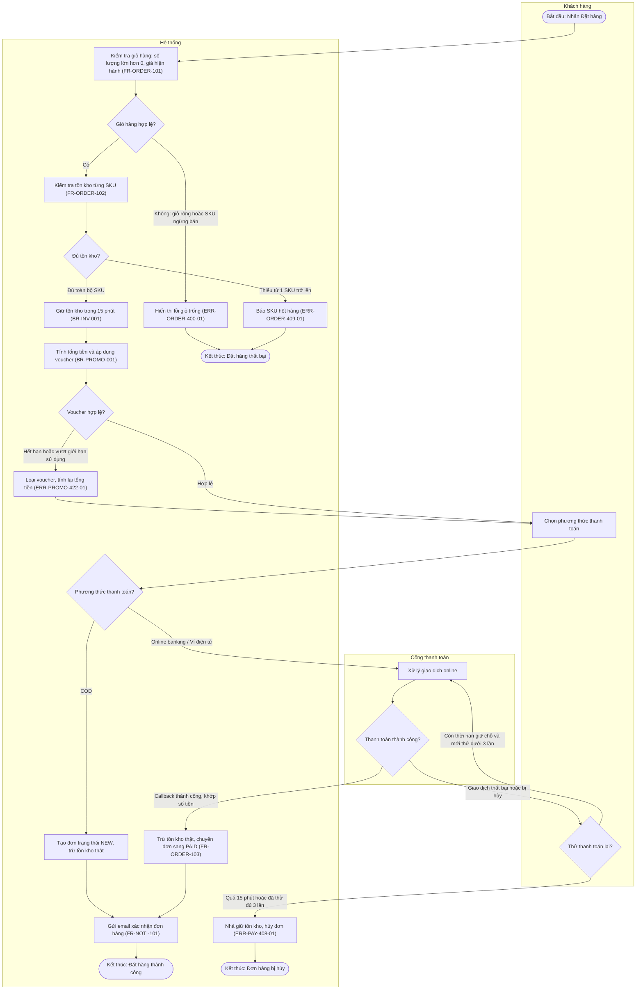

# Sơ đồ Hoạt động Nghiệp vụ (Activity Diagram)

## 1. Thông tin tài liệu
- **Phân hệ / Feature**: Đặt hàng & Thanh toán (Checkout)
- **Use Case đối chiếu**: `UC-ORDER-001` - Đặt hàng trực tuyến
- **User Story gốc**: `US-ORDER-01` - Đặt hàng từ giỏ hàng
- **Đường dẫn lưu trữ**: `docs/{feature}/srs/activity.md`
- **Phiên bản**: 1.0.0

## 2. Điểm Bắt đầu & Kết thúc (Start / Terminal Points)
| Điểm | Ký hiệu trong sơ đồ | Mô tả | Điều kiện đi tới |
| :--- | :--- | :--- | :--- |
| Bắt đầu | `S([Bắt đầu])` | Khách hàng nhấn nút "Đặt hàng" tại màn hình Giỏ hàng | Giỏ hàng đã được tải đầy đủ |
| Kết thúc 1 | `E1([Kết thúc: Đặt hàng thành công])` | Đơn hàng ở trạng thái `NEW` (COD) hoặc `PAID` (Online), email xác nhận đã gửi | Toàn bộ kiểm tra hợp lệ và thanh toán thành công |
| Kết thúc 2 | `E2([Kết thúc: Đặt hàng thất bại])` | Không tạo đơn, khách ở lại màn hình Giỏ hàng kèm thông báo lỗi | Giỏ rỗng hoặc thiếu tồn kho |
| Kết thúc 3 | `E3([Kết thúc: Đơn hàng bị hủy])` | Đơn chuyển trạng thái `CANCELLED`, tồn kho giữ chỗ được nhả | Hết thời hạn giữ chỗ hoặc thử thanh toán lại quá 3 lần |

## 3. Sơ đồ Hoạt động (Mermaid Flowchart)

## 4. Bảng Điều kiện Rẽ nhánh & Guard Clause
| Mã nút | Nội dung quyết định | Nhánh | Điều kiện kích hoạt (Guard) | Hành động tại nhánh |
| :--- | :--- | :--- | :--- | :--- |
| `D1` | Giỏ hàng hợp lệ? | Không | Giỏ rỗng hoặc có SKU ngừng bán | Trả lỗi `ERR-ORDER-400-01`, giữ nguyên màn hình Giỏ hàng |
| `D1` | Giỏ hàng hợp lệ? | Có | Mọi SKU có số lượng lớn hơn 0 và giá hiện hành | Chuyển sang kiểm tra tồn kho |
| `D2` | Đủ tồn kho? | Thiếu | Từ 1 SKU trở lên có tồn kho khả dụng nhỏ hơn số lượng đặt | Trả lỗi `ERR-ORDER-409-01` kèm danh sách SKU thiếu |
| `D2` | Đủ tồn kho? | Đủ | Toàn bộ SKU đủ tồn kho khả dụng | Giữ tồn kho 15 phút theo `BR-INV-001` |
| `D3` | Voucher hợp lệ? | Không | Voucher hết hạn, sai điều kiện đơn tối thiểu, hoặc vi phạm `BR-PROMO-001` (tối đa 01 voucher sản phẩm và 01 voucher freeship) | Loại voucher, tính lại tổng tiền, trả lỗi `ERR-PROMO-422-01` |
| `D3` | Voucher hợp lệ? | Có | Voucher trong hạn và thỏa `BR-PROMO-001` | Trừ giảm giá vào tổng tiền |
| `D4` | Phương thức thanh toán? | COD | Khách chọn thanh toán khi nhận hàng | Tạo đơn `NEW`, trừ tồn kho thật |
| `D4` | Phương thức thanh toán? | Online | Khách chọn online banking hoặc ví điện tử | Điều hướng sang Cổng thanh toán |
| `D5` | Thanh toán thành công? | Có | Callback thành công và số tiền khớp tổng đơn | Trừ tồn kho thật, chuyển đơn sang `PAID` |
| `D5` | Thanh toán thành công? | Không | Giao dịch thất bại hoặc khách hủy trên cổng | Mở nhánh thử lại |
| `RETRY` | Thử thanh toán lại? | Có | Đơn còn thời hạn giữ chỗ 15 phút và số lần thử nhỏ hơn 3 | Quay lại bước xử lý giao dịch |
| `RETRY` | Thử thanh toán lại? | Không | Quá 15 phút giữ chỗ hoặc đã thử đủ 3 lần | Hủy đơn, nhả tồn kho, trả lỗi `ERR-PAY-408-01` |

## 5. Ma trận Truy vết Yêu cầu (Traceability)
| Bước hoạt động | Functional Requirement | Business Rule | Mã lỗi | Nguồn nghiệp vụ |
| :--- | :--- | :--- | :--- | :--- |
| Kiểm tra giỏ hàng | `FR-ORDER-101` | - | `ERR-ORDER-400-01` | `UC-ORDER-001` bước 2 |
| Kiểm tra tồn kho | `FR-ORDER-102` | - | `ERR-ORDER-409-01` | `UC-ORDER-001` bước 3 |
| Giữ tồn kho 15 phút | - | `BR-INV-001` | - | `US-ORDER-01` |
| Áp dụng voucher | - | `BR-PROMO-001` | `ERR-PROMO-422-01` | `UC-ORDER-001` nhánh 4a |
| Xử lý thanh toán online & thử lại | `FR-ORDER-103` | - | `ERR-PAY-408-01` | `UC-ORDER-001` nhánh 6a, 6b |
| Gửi email xác nhận | `FR-NOTI-101` | - | - | `UC-ORDER-001` bước 8 |
