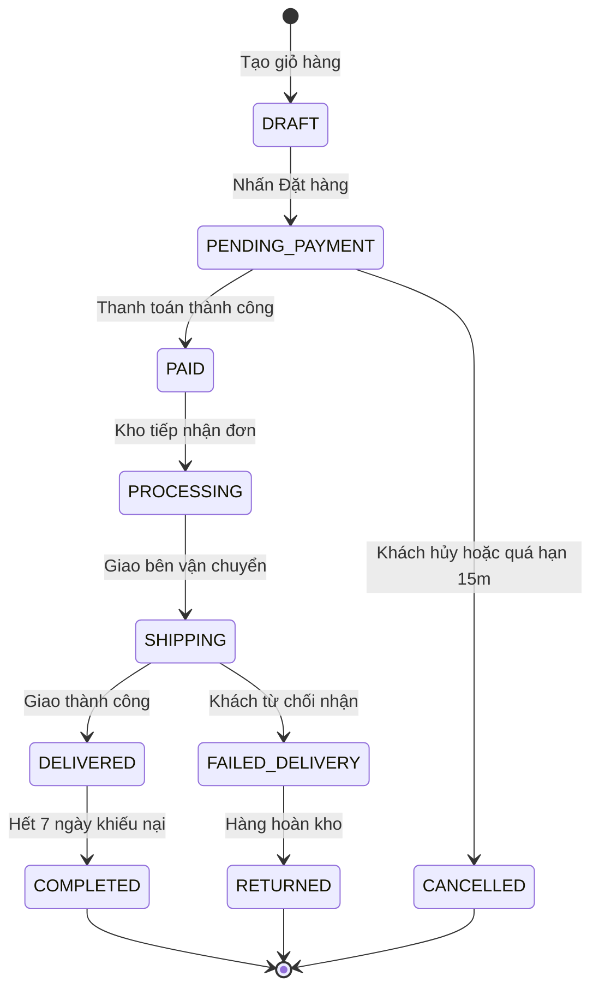

# Sơ đồ và Ma trận Trạng thái Thực thể (State Machine Diagram)

## Ngữ cảnh: Vòng đời Đơn hàng (Order State Machine)

## Ma trận Chuyển dịch Trạng thái (State Transition Matrix)
| Trạng thái hiện tại | Sự kiện kích hoạt (Trigger) | Điều kiện bảo vệ (Guard) | Trạng thái đích | Vai trò thực hiện | Hành động kèm theo (Side effects) |
| :--- | :--- | :--- | :--- | :--- | :--- |
| `DRAFT` | `checkout_submit` | Giỏ có hàng, thông tin hợp lệ | `PENDING_PAYMENT` | Khách hàng | Giữ tồn kho (Hold inventory 15m) |
| `PENDING_PAYMENT`| `payment_success` | Webhook thanh toán khớp số tiền| `PAID` | Cổng thanh toán (Webhook) | Trừ tồn kho thật, gửi email xác nhận |
| `PENDING_PAYMENT`| `timeout_15m` | Chưa thanh toán sau 15 phút | `CANCELLED` | Hệ thống (Tác vụ định kỳ) | Nhả giữ tồn kho (Release inventory) |
