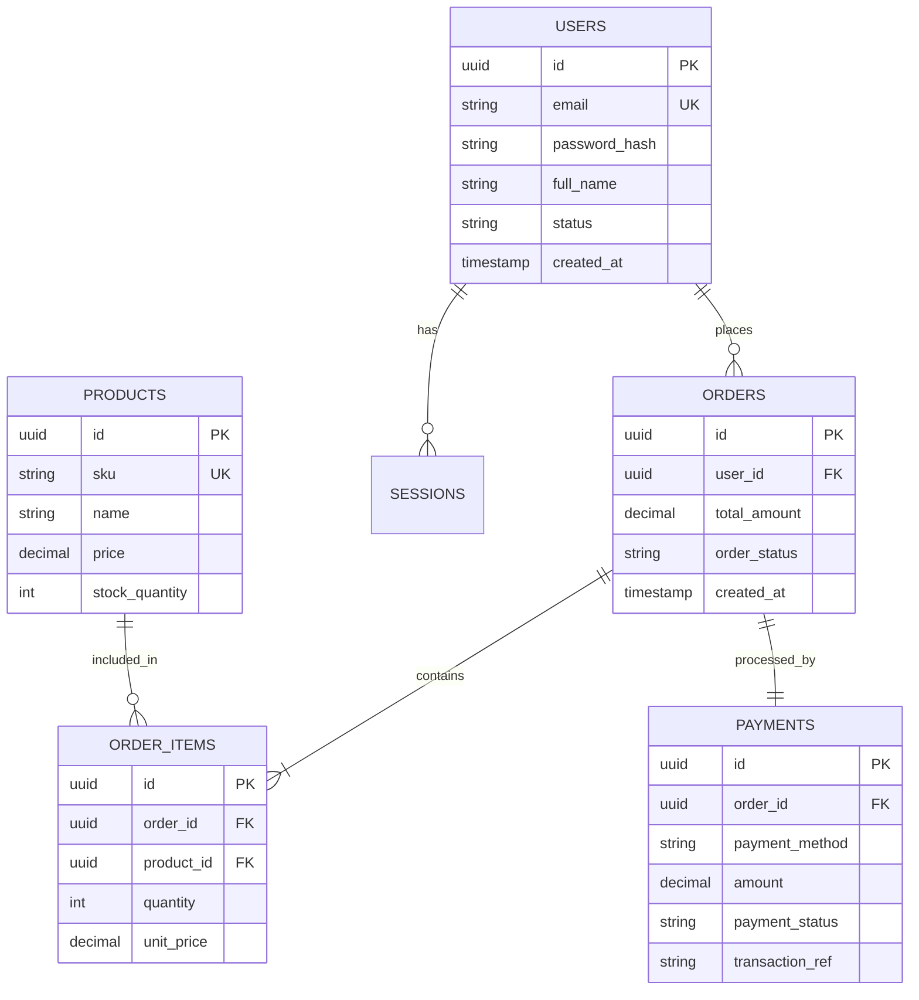

# Sơ đồ Quan hệ Thực thể (Entity Relationship Diagram - ERD)

## Từ điển Dữ liệu (Data Dictionary)

### Bảng: USERS

| Tên trường (Logical) | Tên cột (Physical) | Kiểu dữ liệu | Độ dài | Cho phép Null? | Khóa (PK/FK) | Ràng buộc / Giá trị mặc định | Diễn giải nghiệp vụ |
| :--- | :--- | :--- | :--- | :--- | :--- | :--- | :--- |
| Mã người dùng | id | UUID | 36 | Không | PK | gen_random_uuid() | Định danh duy nhất toàn hệ thống |
| Email | email | VARCHAR | 255 | Không | UK | Regex RFC 5322 | Email dùng để đăng nhập và thông báo |
| Mật khẩu mã hoá | password_hash | VARCHAR | 255 | Không | - | Chuẩn Argon2id | Mật khẩu đã được băm an toàn |
| Họ và tên | full_name | VARCHAR | 100 | Có | - | - | Tên hiển thị của người dùng |
| Trạng thái | status | ENUM | - | Không | - | Default: ACTIVE | ACTIVE, INACTIVE, BANNED |
| Thời điểm tạo | created_at | TIMESTAMPTZ | - | Không | - | CURRENT_TIMESTAMP | Thời điểm tạo bản ghi |

### Bảng: ORDERS

| Tên trường (Logical) | Tên cột (Physical) | Kiểu dữ liệu | Độ dài | Cho phép Null? | Khóa (PK/FK) | Ràng buộc / Giá trị mặc định | Diễn giải nghiệp vụ |
| :--- | :--- | :--- | :--- | :--- | :--- | :--- | :--- |
| Mã đơn hàng | id | UUID | 36 | Không | PK | gen_random_uuid() | Định danh duy nhất của đơn hàng |
| Mã người dùng | user_id | UUID | 36 | Không | FK → USERS.id | ON DELETE RESTRICT | Người đặt đơn hàng |
| Tổng giá trị đơn | total_amount | DECIMAL | (19,2) | Không | - | CHECK (total_amount >= 0) | Tổng tiền phải thanh toán |
| Trạng thái đơn hàng | order_status | ENUM | - | Không | - | Default: PENDING | PENDING, CONFIRMED, SHIPPED, DELIVERED, CANCELLED |
| Thời điểm tạo | created_at | TIMESTAMPTZ | - | Không | - | CURRENT_TIMESTAMP | Thời điểm đặt hàng |

### Bảng: ORDER_ITEMS

| Tên trường (Logical) | Tên cột (Physical) | Kiểu dữ liệu | Độ dài | Cho phép Null? | Khóa (PK/FK) | Ràng buộc / Giá trị mặc định | Diễn giải nghiệp vụ |
| :--- | :--- | :--- | :--- | :--- | :--- | :--- | :--- |
| Mã dòng đơn hàng | id | UUID | 36 | Không | PK | gen_random_uuid() | Định danh duy nhất của dòng đơn hàng |
| Mã đơn hàng | order_id | UUID | 36 | Không | FK → ORDERS.id | ON DELETE CASCADE | Đơn hàng chứa dòng này |
| Mã sản phẩm | product_id | UUID | 36 | Không | FK → PRODUCTS.id | ON DELETE RESTRICT | Sản phẩm được đặt |
| Số lượng | quantity | INT | - | Không | - | CHECK (quantity > 0) | Số lượng sản phẩm đặt mua |
| Đơn giá | unit_price | DECIMAL | (19,2) | Không | - | CHECK (unit_price >= 0) | Giá bán tại thời điểm đặt hàng |

### Bảng: PRODUCTS

| Tên trường (Logical) | Tên cột (Physical) | Kiểu dữ liệu | Độ dài | Cho phép Null? | Khóa (PK/FK) | Ràng buộc / Giá trị mặc định | Diễn giải nghiệp vụ |
| :--- | :--- | :--- | :--- | :--- | :--- | :--- | :--- |
| Mã sản phẩm | id | UUID | 36 | Không | PK | gen_random_uuid() | Định danh duy nhất của sản phẩm |
| Mã SKU | sku | VARCHAR | 50 | Không | UK | Không trùng lặp | Mã quản lý kho của sản phẩm |
| Tên sản phẩm | name | VARCHAR | 255 | Không | - | - | Tên hiển thị của sản phẩm |
| Giá bán | price | DECIMAL | (19,2) | Không | - | CHECK (price >= 0) | Giá bán niêm yết hiện tại |
| Số lượng tồn kho | stock_quantity | INT | - | Không | - | Default: 0; CHECK (stock_quantity >= 0) | Số lượng sản phẩm còn trong kho |

### Bảng: PAYMENTS

| Tên trường (Logical) | Tên cột (Physical) | Kiểu dữ liệu | Độ dài | Cho phép Null? | Khóa (PK/FK) | Ràng buộc / Giá trị mặc định | Diễn giải nghiệp vụ |
| :--- | :--- | :--- | :--- | :--- | :--- | :--- | :--- |
| Mã thanh toán | id | UUID | 36 | Không | PK | gen_random_uuid() | Định danh duy nhất của giao dịch thanh toán |
| Mã đơn hàng | order_id | UUID | 36 | Không | FK → ORDERS.id | ON DELETE RESTRICT | Đơn hàng được thanh toán |
| Phương thức thanh toán | payment_method | ENUM | - | Không | - | - | COD, BANK_TRANSFER, E_WALLET, CREDIT_CARD |
| Số tiền | amount | DECIMAL | (19,2) | Không | - | CHECK (amount >= 0) | Số tiền thực thanh toán |
| Trạng thái thanh toán | payment_status | ENUM | - | Không | - | Default: PENDING | PENDING, SUCCESS, FAILED, REFUNDED |
| Mã tham chiếu giao dịch | transaction_ref | VARCHAR | 100 | Có | UK | Bắt buộc khi payment_status = SUCCESS | Mã giao dịch từ cổng thanh toán |
