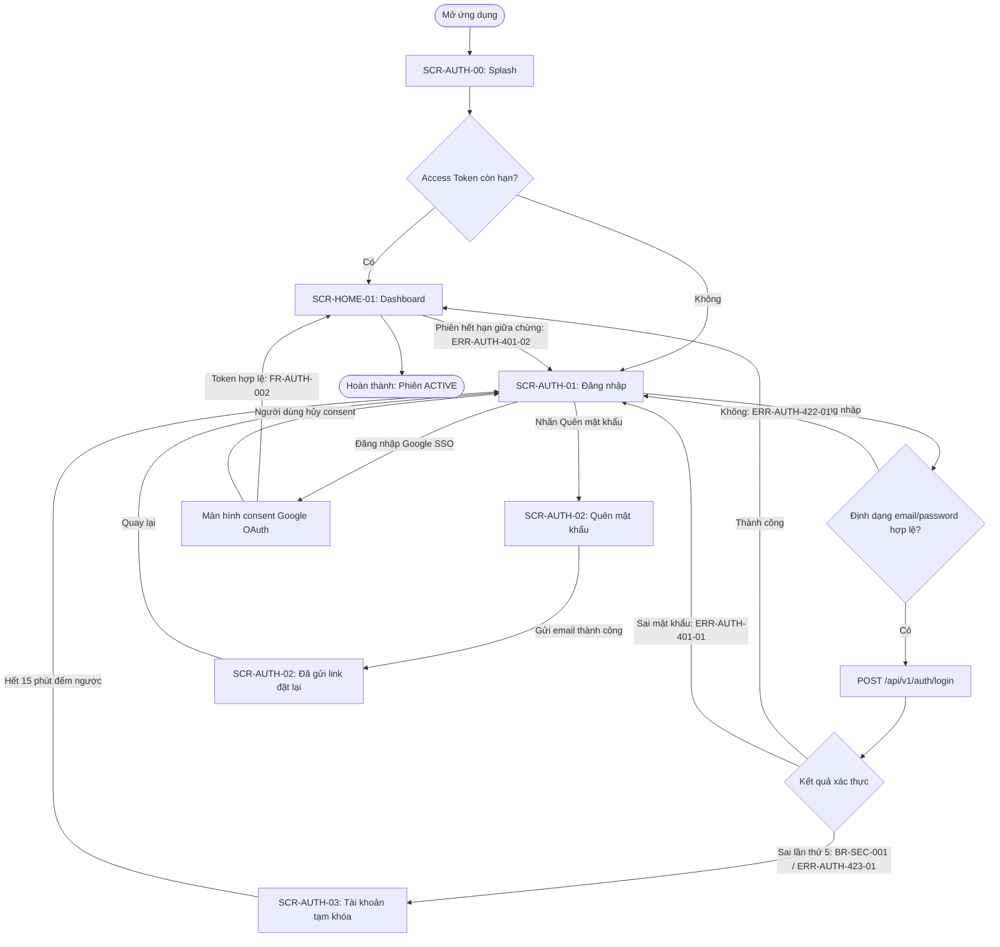

# Sơ đồ Luồng Người dùng & Hành trình Tương tác (User Flow)

## 1. Thông tin tổng quan (Overview)
- **Phân hệ / Feature**: Xác thực người dùng (AUTH)
- **Đường dẫn lưu trữ**: `docs/auth/ui/user-flow.md`
- **Tài liệu tham chiếu**: SRS v1.0.0 (`FR-AUTH-001`, `FR-AUTH-002`), `UC-AUTH-001`, `US-AUTH-01`, `US-AUTH-03`, Wireframe v1.0
- **Điểm vào (Entry point)**: Người dùng mở ứng dụng
- **Điểm hoàn thành (Completion)**: Người dùng vào màn hình Dashboard với phiên đăng nhập `ACTIVE`
- **Ngày cập nhật**: [YYYY-MM-DD]
- **BA phụ trách**: [Tên Agent / BA]

## 2. Sơ đồ Luồng Màn hình từ Điểm vào đến Hoàn thành (Screen Flow)
Bao phủ đủ 3 nhóm luồng: **Happy path** (đăng nhập thành công), **Error path** (sai định dạng, sai mật khẩu) và **Edge case** (khóa tài khoản, hủy SSO, phiên hết hạn giữa chừng).

## 3. Bảng Chuyển tiếp Màn hình & Tương tác (Screen Transition Matrix)
| Mã màn hình | Màn hình nguồn | Sự kiện / Trigger | Điều kiện bảo vệ (Guard) | Màn hình đích | Phản hồi hệ thống / Side effect | Tham chiếu |
| :--- | :--- | :--- | :--- | :--- | :--- | :--- |
| `SCR-AUTH-00` | Splash | `app_launched` | — | `SCR-HOME-01` nếu token còn hạn, ngược lại `SCR-AUTH-01` | Kiểm tra Access Token trong Secure Storage (timeout 2 giây) | `FR-AUTH-001` |
| `SCR-AUTH-01` | Đăng nhập | `submit_login` | Email đúng RFC 5322, password ≥ 8 ký tự | `SCR-HOME-01` | Lưu Access Token (15 phút) & Refresh Token (7 ngày) vào Secure Cookie | `FR-AUTH-001`, `US-AUTH-01`, `UC-AUTH-001` |
| `SCR-AUTH-01` | Đăng nhập | `submit_login` | Sai định dạng email hoặc password < 8 ký tự | Giữ nguyên `SCR-AUTH-01` | Hiển thị lỗi inline dưới ô nhập liệu (`ERR-AUTH-422-01`), không gọi API | `ERR-AUTH-422-01` |
| `SCR-AUTH-01` | Đăng nhập | `submit_login` | Tài khoản tồn tại, sai mật khẩu, `failed_attempts < 5` | Giữ nguyên `SCR-AUTH-01` | Banner đỏ "Email hoặc mật khẩu không chính xác" (`ERR-AUTH-401-01`), ô password reset trống, email giữ nguyên | `ERR-AUTH-401-01` |
| `SCR-AUTH-01` | Đăng nhập | `submit_login` | Sai mật khẩu lần thứ 5 liên tiếp (`BR-SEC-001`) | `SCR-AUTH-03` | Khóa tài khoản 15 phút, hiển thị `ERR-AUTH-423-01` | `BR-SEC-001`, `ERR-AUTH-423-01` |
| `SCR-AUTH-03` | Tài khoản tạm khóa | `countdown_finished` | Đồng hồ đếm ngược về 00:00 | `SCR-AUTH-01` | Mở khóa tài khoản, reset `failed_attempts = 0` | `BR-SEC-001` |
| `SCR-AUTH-01` | Đăng nhập | `tap_forgot_password` | — | `SCR-AUTH-02` | — | `US-AUTH-03` |
| `SCR-AUTH-02` | Quên mật khẩu | `submit_reset_email` | Email đúng RFC 5322 và tồn tại trong hệ thống | Giữ nguyên `SCR-AUTH-02` (trạng thái Đã gửi) | Gửi email chứa link đặt lại (hiệu lực 30 phút), hiển thị màn xác nhận đã gửi | `US-AUTH-03` |
| `SCR-AUTH-01` | Đăng nhập | `tap_google_sso` | Người dùng chấp nhận consent Google | `SCR-HOME-01` | Trao đổi `google_id_token` lấy JWT nội bộ | `FR-AUTH-002`, `US-AUTH-02` |
| `SCR-AUTH-01` | Đăng nhập | `tap_google_sso` | Người dùng hủy màn hình consent | Giữ nguyên `SCR-AUTH-01` | Không ghi log lỗi, không tính `failed_attempts` | `FR-AUTH-002` |
| `SCR-HOME-01` | Dashboard | `token_expired` | Cả Access Token lẫn Refresh Token đều hết hạn | `SCR-AUTH-01` | Xóa phiên cục bộ, hiển thị "Phiên đăng nhập đã hết hạn" (`ERR-AUTH-401-02`) | `BR-SEC-002`, `ERR-AUTH-401-02` |

## 4. Ma trận Trạng thái UI theo Màn hình (UI States)
Mọi màn hình trong luồng bắt buộc khai báo đủ 5 trạng thái; hành vi mô tả phải đo lường được (Rule 16).

| Mã màn hình | Normal | Loading | Empty | Error | Offline |
| :--- | :--- | :--- | :--- | :--- | :--- |
| `SCR-AUTH-01` Đăng nhập | Hiển thị đủ ô Email, ô Password, nút Đăng nhập; nút chỉ enable khi cả 2 ô có dữ liệu | Nút Đăng nhập đổi thành spinner, vô hiệu hóa cả 2 ô nhập; quá 10 giây không có phản hồi thì hủy request và báo `ERR-NET-408-01` | Form trống ban đầu: placeholder "name@example.com" và "Mật khẩu", nút Đăng nhập bị disable | Banner đỏ hiển thị đúng nội dung của mã `ERR-AUTH-422-01` / `ERR-AUTH-401-01`; tự ẩn sau 5 giây | Banner xám "Không có kết nối mạng" ghim đầu màn hình, disable nút Đăng nhập; tự enable lại khi có mạng |
| `SCR-AUTH-02` Quên mật khẩu | Hiển thị ô Email và nút Gửi link đặt lại | Nút Gửi đổi thành spinner trong tối đa 10 giây | Placeholder "name@example.com", nút Gửi bị disable khi ô trống | Email không tồn tại: hiển thị `ERR-AUTH-404-01` "Email chưa đăng ký tài khoản" | Disable nút Gửi, hiển thị banner offline như `SCR-AUTH-01` |
| `SCR-AUTH-03` Tài khoản tạm khóa | Hiển thị đồng hồ đếm ngược 15:00 và nút Liên hệ CSKH | Không áp dụng (màn tĩnh, không gọi API) | Không áp dụng (màn hình không có danh sách dữ liệu) | Không áp dụng (bản thân màn hình là trạng thái lỗi `ERR-AUTH-423-01`) | Đồng hồ đếm ngược vẫn chạy cục bộ; nút Liên hệ CSKH bị disable |
| `SCR-HOME-01` Dashboard | Hiển thị tên người dùng và tối đa 5 đơn hàng gần nhất | Skeleton 3 dòng ở khu vực danh sách đơn trong tối đa 10 giây | Chưa có đơn hàng: hiển thị minh họa trống kèm nút "Tạo đơn hàng đầu tiên" | API lỗi 5xx: hiển thị `ERR-SYS-500-01` kèm nút Thử lại | Hiển thị dữ liệu cache lần tải gần nhất kèm nhãn "Dữ liệu ngoại tuyến" |
