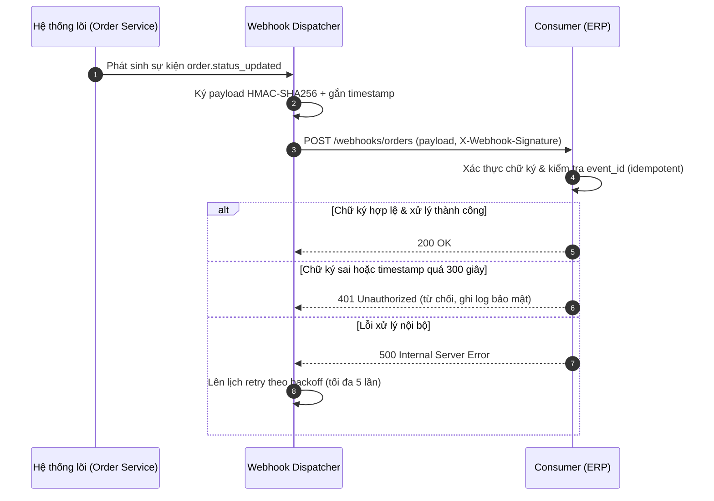

# Đặc tả Hợp đồng API & Tích hợp (API Contract Specification)

## 1. Thông tin tổng quan

| Thuộc tính | Giá trị |
| :--- | :--- |
| **Phân hệ (Feature)** | Xác thực người dùng & Đặt hàng |
| **Phiên bản tài liệu** | v1.0.0 |
| **Base URL** | `https://api.example.com/api/v1` |
| **Đường dẫn lưu trữ** | `docs/{feature}/api/api-spec.md` |
| **Yêu cầu liên quan** | `FR-AUTH-LGN-001`, `FR-ORD-CHKT-001`, `BR-SEC-002` |
| **Ngày rà soát** | 2026-10-22 |

**Nguyên tắc áp dụng (theo Rule 10):**
- Resource URL dùng danh từ số nhiều: `/api/v1/users`, `/api/v1/orders/{order_id}`.
- HTTP Verbs chuẩn: `GET` (truy vấn, idempotent), `POST` (tạo mới), `PUT` (cập nhật toàn bộ, idempotent), `PATCH` (cập nhật một phần), `DELETE` (xóa, idempotent).
- Mọi Response Body tuân theo envelope chuẩn `{ success, data, error, meta, timestamp }`.

## 2. Danh mục Endpoint (RESTful Endpoint Catalog)

| # | Method | Path | Mô tả chức năng | FR liên quan | Xác thực |
| :-: | :--- | :--- | :--- | :--- | :--- |
| 1 | `POST` | `/api/v1/auth/login` | Đăng nhập bằng email & mật khẩu, trả về JWT | `FR-AUTH-LGN-001` | Không |
| 2 | `POST` | `/api/v1/auth/refresh` | Cấp mới Access Token từ Refresh Token | `FR-AUTH-LGN-001` | Refresh Token |
| 3 | `GET` | `/api/v1/users/{user_id}` | Truy vấn hồ sơ người dùng | `FR-AUTH-LGN-001` | Bearer JWT |
| 4 | `POST` | `/api/v1/orders` | Tạo mới đơn hàng | `FR-ORD-CHKT-001` | Bearer JWT |
| 5 | `GET` | `/api/v1/orders` | Truy vấn danh sách đơn hàng (phân trang) | `FR-ORD-CHKT-001` | Bearer JWT |
| 6 | `PATCH` | `/api/v1/orders/{order_id}` | Hủy đơn hàng (chuyển trạng thái `CANCELLED`) | `FR-ORD-CHKT-001` | Bearer JWT |

## 3. Đặc tả chi tiết Endpoint

### 3.1. `POST /api/v1/auth/login` — Đăng nhập Email & Mật khẩu

#### Request Headers
| Header | Bắt buộc | Kiểu | Mô tả |
| :--- | :---: | :--- | :--- |
| `Content-Type` | Có | String | Bắt buộc giá trị `application/json` |
| `X-Request-Id` | Không | UUID | Mã truy vết request phục vụ log & debug |

#### Request Body
```json
{
  "email": "alex@example.com",
  "password": "Secret@123"
}
```

| Trường | Kiểu | Bắt buộc | Ràng buộc validation |
| :--- | :--- | :---: | :--- |
| `email` | String | Có | Định dạng RFC 5322, tối đa 254 ký tự |
| `password` | String | Có | Tối thiểu 8 ký tự, thỏa `BR-SEC-001` |

#### Response 200 OK
```json
{
  "success": true,
  "data": {
    "user_id": "usr_01HF8ZXY2M",
    "full_name": "Alex Nguyen",
    "access_token": "eyJhbGciOiJSUzI1NiIs...",
    "refresh_token": "rt_9f8e7d6c5b",
    "expires_in": 900
  },
  "error": null,
  "meta": null,
  "timestamp": "2026-10-22T10:30:00Z"
}
```

#### Error Responses (400, 401, 404, 422, 500)
```json
{
  "success": false,
  "data": null,
  "error": {
    "code": "ERR-AUTH-401-01",
    "message": "Email hoặc mật khẩu không chính xác."
  },
  "meta": null,
  "timestamp": "2026-10-22T10:30:05Z"
}
```

| HTTP Status | Mã ERR | Điều kiện phát sinh |
| :---: | :--- | :--- |
| 400 | `ERR-AUTH-400-01` | Body request thiếu trường bắt buộc hoặc sai kiểu dữ liệu JSON |
| 401 | `ERR-AUTH-401-01` | Email không tồn tại hoặc mật khẩu không khớp hash đã lưu |
| 404 | `ERR-AUTH-404-01` | Không áp dụng cho endpoint này (path tồn tại), dành cho route không khai báo |
| 422 | `ERR-AUTH-422-01` | Email sai định dạng hoặc mật khẩu vi phạm `BR-SEC-001` |
| 500 | `ERR-SYS-500-01` | Lỗi hệ thống không xác định, ghi log theo `X-Request-Id` |

### 3.2. `POST /api/v1/orders` — Tạo mới đơn hàng

#### Request Headers
| Header | Bắt buộc | Kiểu | Mô tả |
| :--- | :---: | :--- | :--- |
| `Authorization` | Có | String | `Bearer <access_token>` |
| `Content-Type` | Có | String | Bắt buộc giá trị `application/json` |
| `Idempotency-Key` | Có | UUID | Chống tạo trùng đơn khi client retry, TTL 24 giờ |

#### Request Body
```json
{
  "items": [
    { "product_id": "prd_1001", "quantity": 2, "unit_price": 150000 }
  ],
  "voucher_code": "SALE10",
  "shipping_address_id": "addr_2099"
}
```

| Trường | Kiểu | Bắt buộc | Ràng buộc validation |
| :--- | :--- | :---: | :--- |
| `items` | Array | Có | Tối thiểu 1 phần tử; `quantity` nguyên dương ≤ tồn kho |
| `items[].unit_price` | Integer (VND) | Có | ≥ 1.000 VND, khớp giá hiện hành tại thời điểm đặt |
| `voucher_code` | String | Không | Thỏa `BR-PROMO-001` (tối đa 01 voucher sản phẩm + 01 voucher freeship) |
| `shipping_address_id` | String | Có | Thuộc sở hữu của người dùng đang đăng nhập |

#### Response 200 OK
```json
{
  "success": true,
  "data": {
    "order_id": "ord_5001",
    "status": "NEW",
    "total_amount": 270000,
    "discount_amount": 30000,
    "created_at": "2026-10-22T10:35:00Z"
  },
  "error": null,
  "meta": null,
  "timestamp": "2026-10-22T10:35:00Z"
}
```

#### Error Responses (400, 401, 404, 422, 500)
| HTTP Status | Mã ERR | Điều kiện phát sinh |
| :---: | :--- | :--- |
| 400 | `ERR-ORD-400-01` | `Idempotency-Key` thiếu hoặc body rỗng |
| 401 | `ERR-AUTH-401-01` | Access Token hết hạn hoặc chữ ký không hợp lệ |
| 404 | `ERR-ORD-404-01` | `product_id` hoặc `shipping_address_id` không tồn tại |
| 422 | `ERR-ORD-422-05` | Số lượng sản phẩm tồn kho không đủ để đặt hàng |
| 500 | `ERR-SYS-500-01` | Lỗi hệ thống không xác định, ghi log theo `X-Request-Id` |

## 4. Ma trận Lỗi API tổng hợp (Error Matrix)

| Mã ERR | HTTP Status | Thông báo hiển thị (End-User) | Thông báo kỹ thuật (Dev/Log) | Hướng xử lý đề xuất |
| :--- | :---: | :--- | :--- | :--- |
| `ERR-AUTH-400-01` | 400 | Dữ liệu gửi lên chưa hợp lệ. | Missing required field in request body | Kiểm tra schema Request Body, hiển thị lỗi form tổng quát |
| `ERR-AUTH-401-01` | 401 | Email hoặc mật khẩu không chính xác. | Credential mismatch / token expired | Với login: báo lỗi chung chống user-enumeration; với API khác: chuyển hướng Login |
| `ERR-ORD-404-01` | 404 | Sản phẩm hoặc địa chỉ không tồn tại. | Resource not found: product_id / address_id | Làm mới giỏ hàng, loại bỏ item lỗi |
| `ERR-AUTH-422-01` | 422 | Email không đúng định dạng. | Validation failed: email invalid format | Focus vào input Email, hiển thị inline helper text đỏ |
| `ERR-ORD-422-05` | 422 | Sản phẩm đã hết hàng hoặc không đủ số lượng. | Insufficient stock for product_id | Gợi ý giảm số lượng hoặc xóa item khỏi giỏ |
| `ERR-SYS-500-01` | 500 | Hệ thống đang bận. Vui lòng thử lại sau. | Unhandled exception, trace_id = X-Request-Id | Retry sau 30 giây, tối đa 3 lần; báo SRE nếu lặp lại |

## 5. Cơ chế Webhook / Callback

### 5.1. Danh mục sự kiện Webhook
| Sự kiện (Event) | Điều kiện kích hoạt | Hệ thống nhận (Consumer) |
| :--- | :--- | :--- |
| `order.status_updated` | Đơn hàng chuyển trạng thái (`PAID`, `SHIPPING`, `COMPLETED`, `CANCELLED`) | Hệ thống ERP / Email Service |
| `payment.completed` | Giao dịch thanh toán ghi nhận thành công | Hệ thống kế toán |

### 5.2. Payload mẫu — `order.status_updated`
```json
{
  "event": "order.status_updated",
  "event_id": "evt_8842",
  "occurred_at": "2026-10-22T11:00:00Z",
  "data": {
    "order_id": "ord_5001",
    "previous_status": "PAID",
    "current_status": "SHIPPING"
  }
}
```

### 5.3. Quy tắc xác thực chữ ký (Signature Verification)
- Mỗi request webhook mang header `X-Webhook-Signature` và `X-Webhook-Timestamp`.
- Chữ ký là chuỗi `HMAC-SHA256(secret, timestamp + "." + raw_body)` mã hóa hex; consumer bắt buộc tính lại và so sánh bằng thuật toán constant-time.
- Consumer từ chối request có `X-Webhook-Timestamp` lệch quá 300 giây so với giờ hệ thống (chống replay attack).
- Chuỗi `secret` cấp riêng cho từng consumer, độ dài tối thiểu 32 ký tự, rotate định kỳ 90 ngày.

### 5.4. Chính sách Retry & Idempotency
- HTTP response 2xx từ consumer được coi là nhận thành công; mọi mã khác hoặc timeout 10 giây kích hoạt retry.
- Retry tối đa 5 lần theo backoff lũy tiến: 1 phút, 5 phút, 30 phút, 2 giờ, 6 giờ; sau đó chuyển vào Dead Letter Queue và cảnh báo SRE.
- Consumer bắt buộc xử lý idempotent dựa trên `event_id` (một `event_id` chỉ được xử lý đúng 1 lần trong vòng 72 giờ).

### 5.5. Luồng giao nhận Webhook


## 6. Yêu cầu vận hành & Phi chức năng (đo lường được)

| Hạng mục | Ngưỡng bắt buộc |
| :--- | :--- |
| Hiệu năng | Thời gian phản hồi API P95 dưới 500ms với 500 CCU |
| Rate Limit | 10 req/min/IP cho `/api/v1/auth/login`; 100 req/min/user cho các endpoint còn lại |
| Bảo mật | Mật khẩu mã hóa Argon2id; toàn bộ traffic bắt buộc TLS 1.2 trở lên |
| Versioning | Phiên bản trong URL (`/api/v1`); thay đổi breaking phải duy trì song song tối thiểu 6 tháng |
| Độ phủ mã lỗi | Có mã ERR xác định cho toàn bộ mã phản hồi HTTP 4xx và 5xx |

## 7. Lịch sử sửa đổi (Revision History)

| Phiên bản | Ngày | Người thực hiện | Tóm tắt thay đổi |
| :--- | :--- | :--- | :--- |
| 1.0.0 | 2026-10-22 | BA-Kit | Ban hành đặc tả API cho phân hệ Xác thực & Đặt hàng |
