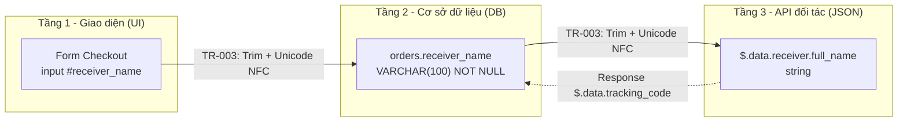

# Ma trận Ánh xạ Dữ liệu 3 Tầng (3-Layer Data Mapping Matrix)

## 1. Thông tin tổng quan
- **Phân hệ / Feature**: Đặt hàng & đồng bộ vận đơn (Order Checkout & Shipping Sync)
- **Endpoint nội bộ**: `POST /api/v1/orders`
- **Endpoint đối tác**: `POST /v2/shipments` (API đối tác vận chuyển GiaoHang Express)
- **Tài liệu đối chiếu**: SRS v1.0.0, Data Dictionary v1.0, API Contract v1.0, Wireframe màn hình Checkout v1.0
- **Đường dẫn lưu trữ**: `docs/{feature}/api/data-mapping.md`
- **Ngày lập**: [YYYY-MM-DD]
- **BA phụ trách**: [Tên BA / Agent]

## 2. Luồng dữ liệu 3 tầng


## 3. Bảng ánh xạ chéo 3 tầng (Cross-Reference Table)
Truy vết: `FR-ORD-CHKT-001` (Tạo đơn hàng và đồng bộ đối tác vận chuyển), `UC-ORD-001`, `US-ORD-01`, `BR-TAX-001`.

| STT | Chiều | Tầng 1 - UI (Màn hình / Label / Input ID) | Tầng 2 - DB (Bảng.Cột / Kiểu / Null) | Tầng 3 - API Field (JSON Path / Kiểu) | Quy tắc chuyển đổi |
| :---: | :---: | :--- | :--- | :--- | :--- |
| 1 | UI → API | Checkout / "Họ và tên người nhận" / `#receiver_name` | `orders.receiver_name` / VARCHAR(100) / NOT NULL | `$.data.receiver.full_name` / string | TR-003 |
| 2 | UI → API | Checkout / "Số điện thoại" / `#receiver_phone` | `orders.receiver_phone` / VARCHAR(15) / NOT NULL | `$.data.receiver.phone` / string | TR-004 |
| 3 | UI → API | Checkout / "Địa chỉ chi tiết" / `#receiver_address` | `orders.receiver_address` / VARCHAR(255) / NOT NULL | `$.data.receiver.address.line1` / string | TR-003 |
| 4 | UI → API | Checkout / "Tỉnh/Thành phố" / `#receiver_province` | `orders.receiver_province_code` / CHAR(3) / NOT NULL | `$.data.receiver.address.province_code` / string | TR-005 |
| 5 | UI → API | Checkout / "Tổng tiền hàng" (hiển thị `1.250.000 ₫`) | `orders.total_amount` / NUMERIC(15,2) / NOT NULL | `$.data.payment.amount` / integer | TR-001 |
| 6 | UI → API | Checkout / "Phí vận chuyển" | `orders.shipping_fee` / NUMERIC(15,2) / NOT NULL | `$.data.payment.shipping_fee` / integer | TR-001 |
| 7 | UI → API | Checkout / "Thời điểm đặt hàng" (hiển thị `dd/MM/yyyy HH:mm`) | `orders.created_at` / TIMESTAMPTZ / NOT NULL | `$.data.order.created_at` / string | TR-002 |
| 8 | UI → API | Checkout / "Ghi chú giao hàng" / `#delivery_note` | `orders.delivery_note` / VARCHAR(500) / NULL | `$.data.order.note` / string | TR-006 |
| 9 | UI → API | Checkout / "Mã đơn hàng" (sinh tự động) | `orders.order_code` / VARCHAR(20) / NOT NULL | `$.data.order.order_code` / string | Không biến đổi |
| 10 | DB → API | Không hiển thị (tổng hợp từ chi tiết đơn) | `orders.total_weight_gram` / INTEGER / NOT NULL | `$.data.package.weight_gram` / integer | TR-007 |
| 11 | API → UI | Danh sách đơn / "Mã vận đơn" | `orders.partner_tracking_code` / VARCHAR(50) / NULL | Response `$.data.tracking_code` / string | TR-006 |

## 4. Quy tắc Chuyển đổi Dữ liệu (Transformation Rules)
Mọi quy tắc phải phát biểu đo lường được, tuyệt đối không dùng từ ngữ mơ hồ (Rule 16).

| Mã TR | Nhóm | Quy tắc chính xác | Ví dụ đầu vào → đầu ra |
| :--- | :--- | :--- | :--- |
| TR-001 | Currency | Số tiền lưu DB dạng NUMERIC(15,2) đơn vị VND; khi gửi API đối tác ép kiểu integer (bỏ phần thập phân, làm tròn half-up); UI hiển thị theo locale `vi-VN` với dấu phân cách nghìn `.` và hậu tố `₫` | `1250000.00` → API `1250000`; UI `1.250.000 ₫` |
| TR-002 | Date-time | DB lưu TIMESTAMPTZ múi giờ UTC; API gửi/nhận chuỗi ISO 8601 UTC hậu tố `Z`; UI hiển thị múi giờ `Asia/Ho_Chi_Minh` định dạng `dd/MM/yyyy HH:mm` | `2026-10-22 03:30:00+00` → API `2026-10-22T03:30:00Z`; UI `22/10/2026 10:30` |
| TR-003 | Encoding | Chuỗi nhập tự do phải trim khoảng trắng hai đầu, gom khoảng trắng lặp thành 1 ký tự, chuẩn hóa Unicode dạng NFC trước khi lưu DB và trước khi gửi API | `"  Nguyễn   Văn A "` → `"Nguyễn Văn A"` |
| TR-004 | Encoding | Số điện thoại loại bỏ toàn bộ ký tự không phải số, chuyển đầu số `0` nội địa sang mã quốc gia `+84` theo chuẩn E.164, tối đa 15 ký tự | `0901 234 567` → `+84901234567` |
| TR-005 | Mã hóa danh mục | Tỉnh/Thành ánh xạ theo bảng mã 3 ký tự do đối tác công bố (vd `HCM`, `HAN`); giá trị không có trong bảng mã bị từ chối với lỗi `ERR-ORD-422-05` | UI `TP. Hồ Chí Minh` → DB/API `HCM` |
| TR-006 | Nullability | Trường NULL ở DB thì **loại bỏ hoàn toàn key** khỏi JSON payload (không gửi `"note": null`); chiều ngược lại, key vắng mặt trong response được lưu NULL | `delivery_note IS NULL` → payload không chứa `order.note` |
| TR-007 | Đơn vị đo | Khối lượng chuẩn nội bộ là gram (INTEGER); nếu nguồn tính theo kg phải nhân 1000 và làm tròn lên (ceil) trước khi lưu | `1.25 kg` → `1250` gram |

## 5. Ma trận lỗi ánh xạ (Mapping Error Matrix)
| Mã ERR | HTTP Status | Ngữ cảnh phát sinh | Thông báo hiển thị (End-User) | Hướng xử lý đề xuất |
| :--- | :--- | :--- | :--- | :--- |
| `ERR-ORD-422-05` | 422 | Giá trị UI không ánh xạ được sang mã danh mục đối tác (TR-005) hoặc thiếu trường bắt buộc NOT NULL | Một số thông tin giao hàng chưa hợp lệ. Vui lòng kiểm tra lại. | Focus input lỗi, hiển thị inline helper text đỏ |
| `ERR-SYS-502-01` | 502 | API đối tác không phản hồi trong 10 giây hoặc trả HTTP 5xx | Hệ thống vận chuyển đang gián đoạn. Đơn hàng đã được ghi nhận, vui lòng thử đồng bộ lại sau. | Đơn giữ trạng thái `PENDING_SYNC`, xếp hàng retry 3 lần, mỗi lần cách nhau 5 phút |

## 6. Ví dụ Payload hoàn chỉnh
Request gửi đối tác sau khi áp dụng đầy đủ TR-001 → TR-007:
```json
{
  "success": true,
  "data": {
    "order": {
      "order_code": "ORD-20261022-0001",
      "created_at": "2026-10-22T03:30:00Z",
      "note": "Giao giờ hành chính"
    },
    "receiver": {
      "full_name": "Nguyễn Văn A",
      "phone": "+84901234567",
      "address": {
        "line1": "123 Lê Lợi, Phường Bến Nghé",
        "province_code": "HCM"
      }
    },
    "package": { "weight_gram": 1250 },
    "payment": { "amount": 1250000, "shipping_fee": 30000 }
  },
  "error": null,
  "meta": null,
  "timestamp": "2026-10-22T03:30:05Z"
}
```

## 7. Checklist nghiệm thu
- [ ] Mọi cột DB trong bảng ánh xạ đã khớp Data Dictionary (tên cột, kiểu, ràng buộc Null) theo Rule 09.
- [ ] Mọi endpoint và envelope JSON tuân thủ API Contract theo Rule 10.
- [ ] Mọi quy tắc TR phát biểu định lượng, không còn từ ngữ mơ hồ theo Rule 16.
- [ ] Mọi mã định danh (FR/BR/ERR/UC/US) đúng quy ước định dạng chuẩn.
- [ ] File đã được lưu tại `docs/{feature}/api/data-mapping.md`.
