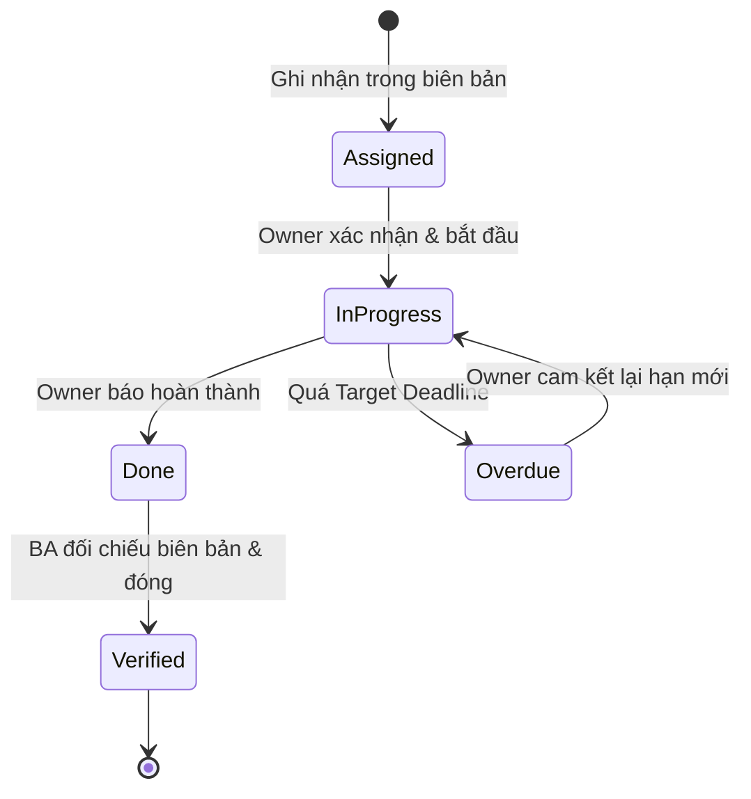

# Biên bản Cuộc họp & Quyết định Nghiệp vụ (Meeting Minutes)

## 1. Thông tin cuộc họp (Meeting Metadata)
- **Mã biên bản**: `MM-2026-001`
- **Tên cuộc họp**: Chốt phạm vi Sprint 3 — Phân hệ Xác thực & Đặt hàng
- **Ngày - Giờ**: 2026-10-22, 14:00–15:30 (GMT+7)
- **Hình thức**: Online qua Google Meet (có ghi hình)
- **Người chủ trì (Facilitator)**: Trần Minh PO — Product Owner
- **Thư ký (Recorder)**: Nguyễn An — Business Analyst
- **Đường dẫn lưu trữ**: `docs/meetings/2026-10-22-meeting.md`
- **Tài liệu tham chiếu**: Báo cáo Gap Analysis (`GAP-001`, `GAP-003`), Báo cáo tác động `CR-2026-001`, SRS v1.0.0, Backlog User Story v1.0

| Vai trò | Họ tên | Đơn vị | Trạng thái tham dự |
| :--- | :--- | :--- | :---: |
| Product Owner | Trần Minh PO | Product | Có mặt |
| Business Analyst | Nguyễn An | Product | Có mặt |
| Tech Lead Backend | Lê Hoàng | Engineering | Có mặt |
| QA Lead | Phạm Thu | QA | Có mặt |
| Security Engineer | Vũ Đức | Security | Có mặt |
| Khách hàng đại diện | — | — | Vắng (đã gửi ý kiến qua email) |

**Mục tiêu cuộc họp**: (1) Chốt phương án xử lý 2 lỗ hổng `GAP-001`, `GAP-003` trước khi khóa SRS v1.1.0; (2) Quyết định go/no-go cho yêu cầu thay đổi `CR-2026-001` (bổ sung xác thực 2 bước TOTP); (3) Phân bổ công việc phát sinh vào Sprint 3.

---

## 2. Tóm tắt nội dung thảo luận (Key Discussion Items)
| STT | Chủ đề | Bối cảnh & Nội dung thảo luận | Trạng thái |
| :---: | :--- | :--- | :--- |
| 1 | Xử lý Google SSO không trả về email | Từ `GAP-001`: tài khoản Google ẩn email chỉ trả về sub ID, khiến hệ thống không tạo được hồ sơ người dùng. Tech Lead đề xuất 2 phương án: (a) từ chối đăng nhập, (b) hiển thị pop-up bắt buộc bổ sung email trước khi kích hoạt tài khoản. PO chọn phương án (b) vì không chặn luồng chuyển đổi. | Đã chốt → `DEC-2026-001` |
| 2 | Chặn hủy đơn khi đang giao hàng | Từ `GAP-003`: người dùng hiện có thể bấm Hủy khi đơn ở trạng thái `SHIPPING`, gây hoàn hàng miễn phí. Cần guard rule tại tầng API lẫn ẩn nút trên UI. QA Lead lưu ý phải cập nhật lại 3 test case hủy đơn hiện hữu. | Đã chốt → `DEC-2026-002` |
| 3 | Go/No-go yêu cầu 2FA (`CR-2026-001`) | Security Engineer trình bày báo cáo tác động: 8.5 ngày công tổng, thêm 2 endpoint, sửa schema bảng `users`. PO xác nhận ưu tiên bảo mật cao hơn tính năng báo cáo `RPT` trong Sprint 3. | Đã chốt → `DEC-2026-003` |

---

## 3. Quyết định chính thức (Formal Decisions)
| Mã Quyết định | Nội dung quyết định | Căn cứ | Tài liệu / Yêu cầu chịu tác động | Người phê duyệt |
| :--- | :--- | :--- | :--- | :--- |
| `DEC-2026-001` | Khi Google SSO không trả về email, hệ thống tạo tài khoản ở trạng thái chờ và hiển thị pop-up bắt buộc nhập email hợp lệ (RFC 5322) trước khi kích hoạt. | Không chặn luồng đăng ký; bảo đảm mọi tài khoản đều có email liên lạc được. | Thêm `FR-AUTH-LGN-003`, `ERR-AUTH-422-02`; sửa `US-AUTH-02`, `AC-AUTH-03` | Product Owner |
| `DEC-2026-002` | Chỉ cho phép hủy đơn khi trạng thái đơn là `NEW` hoặc `PAID`; API trả `ERR-ORD-409-01` và UI ẩn nút Hủy với mọi trạng thái khác. | Tránh hoàn hàng miễn phí khi đơn đã bàn giao cho đơn vị vận chuyển. | Thêm `BR-ORD-001`; sửa `FR-ORD-CNC-001`, `US-ORD-02`, sơ đồ trạng thái đơn hàng | Product Owner |
| `DEC-2026-003` | Chấp thuận `CR-2026-001` (2FA qua Google Authenticator TOTP), triển khai trong Sprint 3 thay thế hạng mục báo cáo `RPT` (dời sang Sprint 4). | Ưu tiên audit bảo mật; phân tích tác động 4 góc độ ở mục 3.1 khả thi trong sprint. | Theo báo cáo tác động `CR-2026-001`; thêm `US-AUTH-05` | Product Owner & Security Team |

### 3.1 Đánh giá tác động quyết định phát sinh thay đổi (áp dụng quy trình CR Impact Matrix — Rule 15)
Quyết định `DEC-2026-003` làm thay đổi phạm vi đã chốt, bắt buộc đánh giá 4 góc độ trước khi cập nhật tài liệu:

| Góc độ tác động | Mức độ | Chi tiết |
| :--- | :---: | :--- |
| **1. Tài liệu (Documentation Drift)** | Cao | SRS thêm 3 FR, 2 BR, 3 ERR; thêm `US-AUTH-05` kèm 2 AC; sửa sơ đồ tuần tự đăng nhập `15-sequence-diagram.md` |
| **2. Kỹ thuật (Technical & Architecture)** | Cao | Bảng `users` thêm cột `totp_secret`, `is_2fa_enabled`; thêm 2 endpoint `/api/v1/auth/2fa/setup`, `/api/v1/auth/2fa/verify`; không breaking change với phiên bản API v1 hiện hữu |
| **3. Kiểm thử (QA & Test Cases)** | Cao | Bổ sung 8 test case mới (OTP đúng, OTP sai, OTP hết hạn, backup code); 2 test case đăng nhập cũ phải viết lại do luồng trả pending token |
| **4. Kế hoạch & Rủi ro (Cost & Schedule)** | Trung bình | Phát sinh 8.5 ngày công; hạng mục `RPT` dời sang Sprint 4; rủi ro: chưa có tài khoản Google Workspace test cho TOTP — cần cấp trước ngày 2026-10-27 |

---

## 4. Action Items (Công việc bàn giao)
| Mã AI | Nội dung công việc | Owner | Target Deadline | Ưu tiên | Trạng thái | Liên kết |
| :--- | :--- | :--- | :---: | :---: | :--- | :--- |
| `AI-2026-001` | Cập nhật SRS v1.1.0: thêm `FR-AUTH-LGN-003`, `BR-ORD-001`, `ERR-AUTH-422-02`, `ERR-ORD-409-01` theo `DEC-2026-001`, `DEC-2026-002` | Nguyễn An (BA) | 2026-10-24 | P0 | Assigned | `DEC-2026-001`, `DEC-2026-002` |
| `AI-2026-002` | Sửa User Story `US-AUTH-02`, `US-ORD-02` và bổ sung `US-AUTH-05` cùng Acceptance Criteria tương ứng | Nguyễn An (BA) | 2026-10-27 | P0 | Assigned | `US-AUTH-05` |
| `AI-2026-003` | Thiết kế migration schema bảng `users` (2 cột 2FA) và gửi review cho Security Team | Lê Hoàng (Tech Lead) | 2026-10-28 | P0 | Assigned | `CR-2026-001` |
| `AI-2026-004` | Viết lại 3 test case hủy đơn và bổ sung 8 test case 2FA vào bộ test Sprint 3 | Phạm Thu (QA Lead) | 2026-10-30 | P1 | Assigned | `DEC-2026-002`, `DEC-2026-003` |
| `AI-2026-005` | Cấp tài khoản Google Workspace test phục vụ kiểm thử TOTP | Vũ Đức (Security) | 2026-10-27 | P1 | Assigned | Mục 3.1 — Rủi ro |

### Vòng đời Action Item

---

## 5. Vấn đề tồn đọng & Chuẩn hóa ngôn từ (Open Issues & Ambiguity Log — áp dụng Rule 16)
Các phát biểu mơ hồ phát sinh trong cuộc họp phải được chuẩn hóa thành yêu cầu đo lường được trước khi đưa vào tài liệu:

| Phát biểu gốc trong cuộc họp | Vấn đề | Cách chuẩn hóa kỹ thuật (được duyệt) | Người xác nhận |
| :--- | :--- | :--- | :--- |
| "Luồng 2FA phải xác thực nhanh, không làm khách hàng chờ" | Không có tiêu chí đo lường cụ thể | Thời gian phản hồi API `/api/v1/auth/2fa/verify` P95 dưới 500ms với 500 CCU | Tech Lead |
| "Pop-up bổ sung email phải dễ thao tác" | Định tính, tùy cảm nhận cá nhân | Người dùng hoàn thành bổ sung email trong tối đa 3 bước: nhập email → nhập mã xác minh → xác nhận | Product Owner |
| "Hệ thống cần cảnh báo sớm khi đơn sắp trễ giao" | Không xác định ngưỡng kích hoạt | Gửi cảnh báo nội bộ khi đơn ở trạng thái `SHIPPING` quá 48 giờ chưa có cập nhật vị trí mới | BA |

**Vấn đề tồn đọng chuyển cuộc họp sau**: Đơn vị vận chuyển chưa xác nhận API callback trạng thái hoàn hàng — QA Lead cung cấp tài liệu tích hợp trước 2026-10-29, chưa chốt được AC cho luồng hoàn hàng.

---

## 6. Xác nhận biên bản (Sign-off)
| Vai trò | Họ tên | Ý kiến | Ngày xác nhận |
| :--- | :--- | :--- | :--- |
| Product Owner | Trần Minh PO | Đồng ý toàn bộ quyết định | 2026-10-22 |
| Business Analyst | Nguyễn An | Đã ghi nhận đầy đủ, không bổ sung | 2026-10-22 |
| Tech Lead Backend | Lê Hoàng | Đồng ý; lưu ý rủi ro ở mục 3.1 | 2026-10-22 |
| QA Lead | Phạm Thu | Đồng ý | 2026-10-22 |
